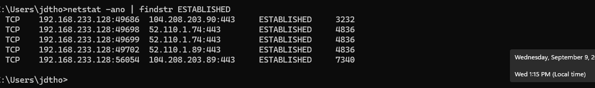
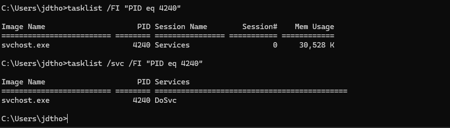
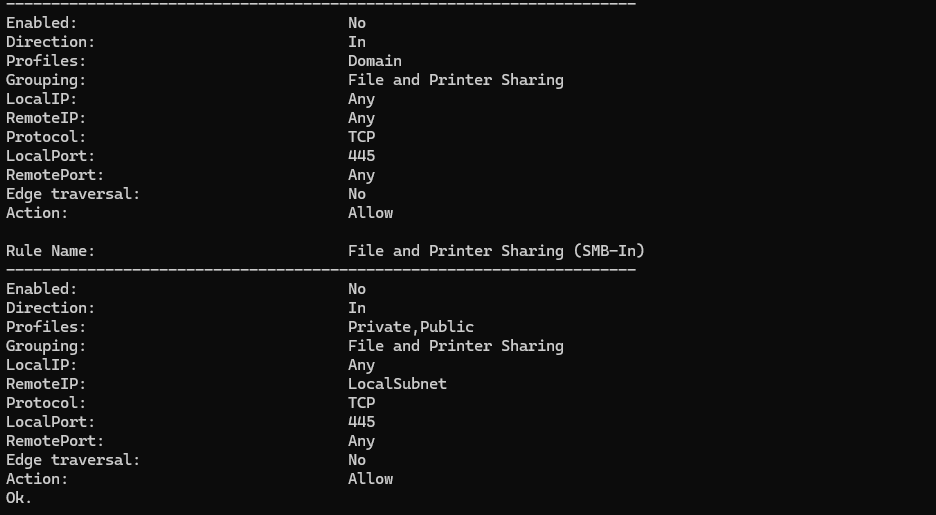

# Phase 03 — Network Security & Investigation

## Overview

This phase focused on building practical network investigation skills from a SOC analyst perspective.
Using Windows networking and system utilities, I examined active network connections, correlated network activity with running processes and services, investigated listening ports, and evaluated firewall context to determine whether observed activity appeared expected or required further investigation.

The investigation workflow used throughout this phase was:

**Connection → PID → Process → Path/Service → Destination → Context → Classification**

## Objectives

- Identify active TCP connections and interpret local IPs, destination IPs, ports, connection states, and PIDs.
- Correlate network connections with the processes and Windows services responsible for them.
- Distinguish between established connections and listening services.
- Investigate common network services and ports including HTTPS (443), SMB (445), DNS (53), and RDP (3389).
- Evaluate listening services alongside Windows Firewall configuration to better understand potential network exposure.
- Classify observed activity based on evidence rather than assuming that unfamiliar traffic is malicious.

- ## Active Network Connection Analysis

I used `netstat -ano` to establish a snapshot of active TCP connections on the Windows system. The output provided the local address and temporary source port, remote destination address and service port, TCP connection state, and the PID responsible for each connection.

Rather than treating every unfamiliar destination as suspicious, I used the connection data as the starting point for further investigation.

### Investigation Example

During analysis, several outbound connections were associated with PID `4240`. Most observed traffic used HTTPS over TCP port `443`, while connections to `20.59.128.16` used TCP port `80`.

Because the HTTP connections differed from the predominantly HTTPS traffic in the snapshot, PID `4240` was selected for additional investigation. The use of port 80 alone was not considered evidence of malicious activity.

## Process and Service Correlation

After identifying PID `4240` in the network connection data, I correlated the PID with the responsible Windows process.

Using `tasklist`, PID `4240` was identified as:

- **Process:** `svchost.exe`
- **PID:** `4240`

Because `svchost.exe` is a generic Windows Service Host process, identifying the executable alone was not enough to determine why the network activity was occurring. I then used `tasklist /svc` to identify the Windows service hosted by that specific process.

PID `4240` was associated with:

- **Service:** `DoSvc`
- **Service Name:** Delivery Optimization

Delivery Optimization is a Windows service used to support the delivery of Windows and Microsoft Store update content. Based on the process, hosted service, and observed network behavior, the activity was consistent with legitimate Windows functionality.

### Classification

**Expected / Normal Activity**

This investigation demonstrated why process names alone should not be used to classify network activity. When a connection maps to `svchost.exe`, the hosted Windows service should also be identified to provide additional context.

## Listening Services and Firewall Exposure

I also examined TCP ports in a `LISTENING` state to identify services waiting for inbound network connections.

One notable listener was:

- **Local Address:** `0.0.0.0`
- **Port:** `445/TCP`
- **State:** `LISTENING`
- **PID:** `4`
- **Process:** `System`
- **Associated Protocol:** SMB (Server Message Block)

The `0.0.0.0:445` listener indicates that the service is bound across available local IPv4 interfaces. However, a listening port does not by itself prove that the service is reachable from another system.

To evaluate the exposure further, I reviewed the Windows Firewall rules associated with File and Printer Sharing over SMB.

The examined inbound SMB rules were configured for TCP port `445` with an `Allow` action, but both rules showed:

**Enabled: No**

This means the specific SMB-In allow rules examined were not active. This finding alone does not prove that TCP port 445 is completely blocked, because additional firewall rules or policies could affect reachability.

### Analyst Finding

**Listening ≠ Reachable ≠ Malicious**

A listening service represents potential attack surface, but its security significance depends on additional context such as firewall configuration, network accessibility, system purpose, authentication controls, and whether the service is expected.

## Key Lessons

- Network connections should be investigated using multiple pieces of evidence rather than classified from an IP address or port alone.
- A PID can connect network activity to the local process responsible for it.
- When a PID maps to `svchost.exe`, identifying the hosted Windows service provides additional context about the activity.
- Common ports such as 80, 443, 445, and 3389 indicate the service or protocol being used, but do not determine whether activity is malicious.
- `ESTABLISHED` represents an active TCP connection, while `LISTENING` represents a local service waiting for connections.
- A listening port does not automatically mean the service is externally reachable.
- Firewall configuration, network accessibility, process context, and expected system behavior should be considered before classifying activity.
- Suspicious or unfamiliar activity should be investigated rather than immediately treated as malicious.

## Outcome

This phase established a repeatable network investigation workflow for future SOC analysis:

**Connection → PID → Process → Path/Service → Destination → Context → Classification**

The exercises strengthened my ability to move from raw network data to an evidence-based assessment of the process, service, and security context responsible for the activity.
